# Propellerhead ReBirth RB-338 v2.0.1: Complete Reference Manual

> **Source:** Extracted directly from `ReBirth.hlp` (Windows Help 4.0 system) & `ReBirth.cnt`.
> Converted to modern Markdown for seamless offline reading, search, and archival on Windows 10/11, macOS, and Linux.

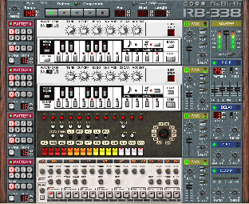

## Table of Contents
- [1. Initial Setup & Audio Configuration](#1-initial-setup--audio-configuration)
  - [1.1 Selecting a Card Driver](#11-selecting-a-card-driver)
  - [1.2 DirectX Drivers: Emulated vs. Native](#12-directx-drivers-emulated-vs-native)
  - [1.3 Selecting an MME Driver](#13-selecting-an-mme-driver)
  - [1.4 Setting the Audio Card Buffer](#14-setting-the-audio-card-buffer)
- [2. Menu Commands Reference](#2-menu-commands-reference)
  - [2.1 File Menu](#21-file-menu)
  - [2.2 Edit Menu](#22-edit-menu)
  - [2.3 Mods Menu](#23-mods-menu)
  - [2.4 Options Menu](#24-options-menu)
  - [2.5 Windows Menu](#25-windows-menu)
  - [2.6 Help Menu](#26-help-menu)
- [3. Dialog Windows Reference](#3-dialog-windows-reference)
  - [3.1 Song Information Dialog](#31-song-information-dialog)
  - [3.2 Transpose Dialog](#32-transpose-dialog)
  - [3.3 Preferences Dialog](#33-preferences-dialog)
  - [3.4 Quick Setup (MIDI Remote Control Mapping)](#34-quick-setup-midi-remote-control-mapping)
  - [3.5 Select Mod Dialog](#35-select-mod-dialog)
- [4. Panel & Instrument Controls Reference](#4-panel--instrument-controls-reference)
  - [4.1 The Active Device Concept & Focus Bar](#41-the-active-device-concept--focus-bar)
  - [4.2 Transport Panel](#42-transport-panel)
  - [4.3 Synth Sections (TB-303 Units 1 & 2)](#43-synth-sections-tb-303-units-1--2)
  - [4.4 808 Rhythm Section (TR-808 Drum Machine)](#44-808-rhythm-section-tr-808-drum-machine)
  - [4.5 909 Rhythm Section (TR-909 Drum Machine)](#45-909-rhythm-section-tr-909-drum-machine)
  - [4.6 Pattern Section](#46-pattern-section)
  - [4.7 Mixer Sections](#47-mixer-sections)
  - [4.8 PCF (Pattern Controlled Filter) Section](#48-pcf-pattern-controlled-filter-section)
  - [4.9 Delay Section](#49-delay-section)
  - [4.10 Distortion (Dist) Section](#410-distortion-dist-section)
  - [4.11 Compressor (Comp) Section](#411-compressor-comp-section)
  - [4.12 Master Section](#412-master-section)
- [5. General Help & System Notes](#5-general-help--system-notes)

---

## 1. Initial Setup & Audio Configuration

### 1.1 Selecting a Card Driver
> Context Identifier: `4FZX_SR`

Before you start using ReBirth you must select an appropriate driver and adjust the buffer setting. Follow the instructions below, this procedure is very important! If you are unsure about the terminology and concepts used in the following topics, look up the chapter "Audio on Computers" in the ReBirth manual. First, you must determine if you have DirectX installed on your system, or not:

1. Open the Preferences dialog (if it isn't already open) and locate the sound card settings.

2. Pull down the Audio Driver pop-up and select the last item.

3. Check the text below the box, does it say "Driver type: Direct X"?

If is does, click " Finding out if your DirectX driver is emulated or not", below. If it doesn't, click "Selecting an MME Driver", below. Finding out if your DirectX driver is emulated or not Selecting an MME Driver

### 1.2 DirectX Drivers: Emulated vs. Native
> Context Identifier: `4FZX_SS`

If (and only if) you have DirectX installed you need to find out if the audio card driver is emulated or not. You should not use an emulated DirectX driver. To find out which type of driver you have, proceed as follows:

1. Pull down the Audio Driver pop-up and select the drivers that correspond to the card you want to use, one by one.

2. For each one, check the text after "Driver type:" below the pop-up.

If one says Direct X only (and the word emulated is not mentioned), use this driver. Then click "Setting the audio card buffer", below. If all say emulated, you should not use any DirectX driver. Instead click "Selecting an MME Driver", below. Selecting an MME Driver Setting the audio card buffer

### 1.3 Selecting an MME Driver
> Context Identifier: `4FZX_ST`

To select the appropriate MME (Multimedia Extensions) driver, proceed as follows:

1. Pull down the Audio Driver pop-up and select the first item on the menu that corresponds to the name of the card you want to use.

You should avoid choosing generic driver names.

2. Check the text below the box, it should say "Driver type: MME". If it doesn't, select another driver.

3. Proceed to the heading "Setting the audio card buffer", below.

Setting the audio card buffer

### 1.4 Setting the Audio Card Buffer
> Context Identifier: `4FZX_SU`

It is very important that you trim the buffer setting properly. The buffer setting is a balance between fast response to control changes on one hand and "safe" audio playback on the other.

1. Open one of the demonstration songs.

2. Activate Playback.

3. Open the Preferences dialog, from the Edit menu.

4. In the Preferences dialog, locate the Playback performance slider and drag it all the way to the right.

5. Now drag the Playback Performance slider to the left, a bit at a time. Try positions further and further to the left, until the sound starts "breaking up" and the Underruns indicator starts incrementing.

6. Drag the fader a little bit to the right, so that the sound is OK again.

If you use DirectX under Windows 95, you will normally be able to trim the buffer sizes down to between 40 and 90 milliseconds. If you use MME under Windows 95, the same figure will normally be around 160 milliseconds.

7. Close the dialog by clicking OK.

You are now finished with your audio settings for ReBirth. The settings you just made are automatically stored in your computer!

## 2. Menu Commands Reference

### 2.1 File Menu

#### New
> Command ID: `3L8W0KT`

This creates a new ReBirth panel. Use this when you want to start on a Song from scratch. The settings and Patterns in the new window are determined by the Preference setting "Patterns and knob settings for new songs". The Song will use the same Mod as the last Song you worked on.

#### Open
> Command ID: `1JEB_YE`

This menu item is used to open saved Song documents. It opens up a regular file dialog where you can locate a Song file on disk and open it.

#### Close
> Command ID: `85R.7G`

This menu item closes the currently active window. If it is a document window, and you have made any changes since you saved it last (or not saved the document at all) you will be asked whether you want to save those changes before closing.

#### Save
> Command ID: `X.9ZRW`

This menu item allows you to save any changes you have made to the currently active document (the one you're working on, or playing). If you have not yet saved the document, selecting this is the same as selecting Save As, see below.

#### Save As
> Command ID: `32S8X4T`

This is used to save a document for the first time, or to save an existing document under a new name or at a new location. A regular file dialog allows you to specify a name and location for the file. ReBirth RB-338 Songs have the document extension ".rbs".

#### Song Information
> Command ID: `HHQED.`

This allows you to enter some information about your Song. This is useful for example if you intend to distribute your files via Internet and want to make people aware of who the creator is.

#### Export Loop as Audio File
> Command ID: `62IL_.C`

This menu item allows you to export the current Song (or a section of it) as an audio file. This file can later be played back from any program that can read audio files in the specified format. You have to be in Song Mode for this option to be active. Only the area inside the Loop is saved. This allows you to specify any section of the Song to be saved, down to a single measure.

#### Run Benchmark Test
> Command ID: `1MEMKQ1`

This function allows you to test whether your computer is fast enough to run ReBirth RB-338 successfully.

1. Quit all other programs.

This will ensure that the results are as accurate as possible.

2. Select "Run Benchmark Test" from the File menu and press [Return] to start the test.

3. Wait while the test finishes (this may take a couple of minutes).

A score of 100 or more means that the computer is enable to run ReBirth. A higher number means that there is processing power left for other programs. For example, a score of 500 indicates that this computer has five times the processing power required to run ReBirth. A score of less than 100 means that this computer is not able to run ReBirth properly. You might still be able to use for example just one synth or one drum machine, but not all sections and effects at once.

#### Recent Documents
> Command ID: `FD9.7A`

In this section of the menu you will find up to four of your most recently opened Song documents. Selecting one of these opens it.

#### Quit
> Command ID: `1JEDC2K`

This will quit the program. If any documents have unsaved changes you will be asked whether you want to save those changes before quitting.

### 2.2 Edit Menu

#### Cut (Pattern/Loop)
> Command ID: `5MTOYKV`

When menu item is grayed out it is because no document is currently open. Cut Pattern Cut Pattern is mainly used together with Paste to move Patterns between Pattern locations. It will copy the selected Pattern in the section with the focus to the Clipboard, and then clear the Pattern location. The Cut Pattern can later be Pasted, from the clipboard, into another Pattern location. Cut Loop Cut Loop  removes measures from the Song and puts them in the Clipboard. More specifically, Cut removes all measures inside the Loop. This can be used for two purposes: When you want to make the Song shorter. Together with Paste, to move measures from one section of the Song to another.

#### Copy
> Command ID: `1JE6_9P`

If this  menu item is grayed out it is because no document is currently open. Copy Pattern This function is used together with Paste to Copy Patterns between Pattern locations. It will copy the selected Pattern in the section with the focus to the Clipboard, from where it can later be Pasted in to another Pattern location. Copy Loop This menu item copies all the measures inside the Loop and puts them in the Clipboard, from where they can be pasted in.

#### Paste
> Command ID: `3IEX_WA`

If this menu item is grayed out it is because no document is currently open. Paste Pattern This will paste the Pattern currently on the Clipboard, into the selected Pattern location in the section with the focus. The Pasted Pattern will replace whatever Pattern was at that location, before. Paste at Song Position Adds the Cut/Copied measures to the Song, beginning at the Song Position. The measures are inserted into the Song, so that it is lengthened. If you for example have Cut four bars, and use "Paste at Song Position", at Song Position 13, you will get four new measures between measure 13 and 16. These contain the pasted material. Whatever was at bar 13 before the operation, is now at bar 17.

#### Paste Replace at Song Position
> Command ID: `56GPEM`

Just as Paste at Song Position, but when this option is selected, the Pasted material overwrites the material currently in those measures. If you Cut four bars, and use "Paste Replace at Song Position", at Song Position 13, the contents of measures 13, 14, 15 and 16 will be replaced by the measures on the Clipboard.

#### Clear Pattern
> Command ID: `85R1PT`

This empties the selected Pattern. For synth Patterns this means that all steps are set as follows: Function:	Setting: Pitch	Low C Note/Pause	Pause (no sound!) Down	Off Up	Off Accent	Off Slide	Off

#### Shift
> Command ID: `8EN5UV`

This shifts the contents of the Pattern one sixteenth note in either direction. For example, if you shift right, what was on the first step will be on the second, what was on the second will be on the third, and so on. In the same example, whatever was on the last step will be on the first. When the focus is on a synth section, only Shift Pattern Left/Right is available. This shifts the entire contents of the Pattern one step in the selected direction. When the focus is on a rhythm section, you have the option of shifting the whole Pattern or just the selected drum sound.

#### Random
> Command ID: `3O1.VZ3`

This creates random synth and drum Patterns. This can be used as an inspirational tool (create a Pattern and modify the parts you don't like) or for completely computer generated music. The exact options available depend on the focus (synth section or rhythm section). Option:	Description: Random Pattern	Creates a complete Pattern with random pitches, accents, slides etc. Random Pitches	Randomizes the pitches of the Pattern without changing anything else. Random Accents etc.	Randomizes the Note/Pause, Accent, Slide and Octave settings for the steps. Random Drum	Randomizes the programming for the selected rhythm instrument.

#### Alter
> Command ID: `4XIP_LC`

This alters existing synth and rhythm Patterns, using the already programmed material as a basis for a new Pattern. It does this by shifting the settings around between the steps in the Patterns. The exact options available depend on the focus (synth section or rhythm section). Option:	Description: Alter Pattern	Alters all aspects of the Pattern. Alter Pitches	Alters the pitches. Alter Accents etc.	Alters the Note/Pause, Accent, Slide and Octave settings. Alter Drum	Alters the rhythm of the selected instrument.

#### Initialize Loop from Pattern Mode
> Command ID: `9MJR.9`

This is used to "initialize" the measures inside the Loop. This can be used as a convenient way to use the settings currently in Pattern mode, as initial settings for some measures in the Song you are building. Please note that this command clears all the Pattern changes and knob recordings currently inside the Loop! When you use "Initialize Loop from Pattern Mode", Events are inserted at the beginning of the Loop, that correspond to  the settings currently made in Pattern mode. That is, the three Patterns selected in Pattern mode will be used, as well as all knob and other control settings. The rest of the Loop is cleared.

#### Initialize Song from Pattern Mode
> Command ID: `2XGVPBE`

This is used to initialize the song, to start over from scratch. It also allows you to use the settings currently in Pattern mode, as initial settings for the Song you are about to build. Please note that this command clears all the Pattern changes and knob recordings currently in the Song! When you use "Initialize Song from Pattern Mode", Events are inserted at the beginning of the Song, that correspond to  the settings currently made in Pattern mode. That is, the three Patterns selected in Pattern mode will be used, as well as all knob and other control settings. The rest of the Song is cleared.

#### Copy Touched Controls to Loop
> Command ID: `19WGAFQ`

This menu item allows you to insert "static" settings for any control, for a number of bars. For example, you might want to adjust some level control, for a specific number of bars.

1. Set up the Loop to encompass that section.

2. Activate Recording.

3. If you want to, also activate playback.

It is often convenient to make a change in playback mode, since you will then hear what you are doing! However, note that when you touch a control in this mode, you will also record that action. Then again, this might not matter since you will in a short while fill the measures in the Loop, with new settings for the controls you just touched!

4. Adjust the controls as desired.

5. When you have the setting right, select Copy Touched Controls to Loop from the Edit menu.

6. Now, events corresponding to the current settings for the controls you have touched, will be inserted at the beginning of the Loop. Other Events for this control are cleared, in the Loop.

7. Deactivate Recording.

#### Copy Touched Controls to Song
> Command ID: `GNBAY8`

This menu item allows you to insert "static" settings for any control, for the whole Song. For example, you might want to turn on the Delay and make sure that it is turned on for the whole Song.

1. Activate Recording.

2. If you want to, also activate playback.

It is often convenient to make a change in playback mode, since you will then hear what you are doing! However, note that when you touch a control in this mode, you will also record that action. Then again, this might not matter since you will in a short while fill the measures in the Loop or in the whole Song, with new settings for the controls you just touched!

3. Adjust the controls as desired.

4. When you have the setting right, select Copy Touched Controls to Song from the Edit menu.

5. Now, events corresponding to the current settings for the controls you have touched, will be inserted at the beginning of the Song. Other Events for this control are cleared.

6. Deactivate Recording.

#### Transpose
> Command ID: `1NJNOZP`

This only applies to synth Patterns. It allows you to transpose the Pattern +/- 12 semitones. Any notes that would fall outside the allowed range of pitches, will be adjusted one octave in either direction.

#### Vintage ReBirth Synth Sound
> Command ID: `2GQGIHD`

This switch allows you to select between two types of synth envelope decay settings: When this switch is turned on, the decay is shorter. This corresponds to the way the envelope always behaved in ReBirth RB-338 version 1.5 and earlier. When this switch is set to off, the decay is slightly longer. This is the standard setting in ReBirth 2.0 and later. When you create new Songs, this switch is by default turned off. However, when you open Songs saved in ReBirth RB-338 version 1.5 or earlier, this switch is automatically activated, so that the Song plays back with the same sound as when it was created.

#### Preferences
> Command ID: `142.SPU`

This dialog contains a number of overall settings and options for the program. See the on-line help for the dialog for more information.

### 2.3 Mods Menu

#### Mod List
> Command ID: `X.4_A0`

These menu items correspond to the "Mods" currently installed in the Mods folder in your ReBirth folder. Selecting one applies it to the current Song.

#### Select Mod
> Command ID: `PS0E.K`

This opens the Mod selector dialog.

#### Scan for New Mod
> Command ID: `.3NH60`

This command "refreshes" the Mod menu, Use this if you have added Mod files to your Mods folder since you last launched ReBirth.

### 2.4 Options Menu

#### Sync to MIDI Clock
> Command ID: `X.0GJU`

When this is activated, ReBirth RB-338 will synchronize its playback to incoming MIDI Clock. When synchronized to MIDI Clock, the tempo is determined by the other device or application, the tempo on the ReBirth transport bar is of no relevance. You do not need to activate Play in ReBirth. As soon as it senses that the other device/application starts, it will start automatically. To decide which MIDI source to synchronize to, open the Preferences dialog and use the Sync Input setting. For more information about external sync, see the Operation Manual.

#### Program Synth from Keyboard
> Command ID: `16IZD2X`

When this is activated, the computer keyboard is used to program the synthesizer that currently has the focus. To learn how to program the synthesizer from the keyboard, see the Operation Manual in Acrobat format.

#### Select Patterns from Keyboard
> Command ID: `I8SLCL`

When this is activated, the computer keyboard is used for selecting Patterns. To learn how to select Patterns from the keyboard, see the Operation Manual in Acrobat format.

#### Stay on top
> Command ID: `2QNE.WY`

When this is activated, the ReBirth program window will always stay on top of all other windows on the computer. This is practical for instance when you synchronize to another program on the same computer and wish to access its transport control without switching in its program window.

#### Resize Application Window to Documents
> Command ID: `1MDI2IQ`

This changes the size of the application window so that exactly fits the document windows.

### 2.5 Windows Menu

#### Cascade
> Command ID: `_CDW40`

This adjusts the positions of the document windows, in an overlapping pattern.

#### Windows menu items
> Command ID: `4U6H0A`

This lists all the open Song documents. Selecting one makes it the active window.

### 2.6 Help Menu

#### Contents
> Command ID: `70TPTX`

This menu item opens up the Topic window for the Windows on-line help system.

#### Go to Propellerhead's Web Page
> Command ID: `51WC_7L`

This menu item will connect you  to the Internet using your preferred browser. The browser will then take you to the entrance to the Propellerhead Web site.

#### Go to Steinberg's Homepage
> Command ID: `1RP4JWP`

This menu item will connect you  to the Internet using your preferred browser. The browser will then take you to Steinberg Soft- & Hardware's Web site.

#### Download ReBirth Songs
> Command ID: `IEH15S`

This menu item will connect you  to the Internet using your preferred browser. The browser will then take you to the Free Songs pages on the Propellerhead Web site.

#### Download ReBirth Mods
> Command ID: `2208FBF`

This menu item will connect you  to the Internet using your preferred browser. The browser will then take you to the Free Mod pages on the Propellerhead Web site.

#### ReBirth Tech Info and Support
> Command ID: `987GZI`

This menu item will connect you  to the Internet using your preferred browser. The browser will then take you to the Tech Support pages on the Propellerhead Web site.

#### Order ReBirth Now
> Command ID: `IAJR3R`

This menu item will connect you  to the Internet using your preferred browser. The browser will then take you to the Order pages on the Propellerheads Web site.

#### About ReBirth RB-338
> Command ID: `83H.9V`

This will open a dialog that tells you what version of ReBirth you are using and something about the people who created the program.

## 3. Dialog Windows Reference

### 3.1 Song Information Dialog

This dialog allows you to enter some information about the song and it's creator. This information is then saved together with the Song file. For more information about each item in the dialog, use the context sensitive help (the question mark symbol) in the actual dialog.

| Control / Field | Description |
|---|---|
| **This text always appears in the Song window title.** |  |
| **This text will appear in the Information dialog and in the splash screen that appears when you load the Song (if Show Information... is activated)** |  |
| **If this is activated, More Information and Creator's Web Page will appear in a window when the Song opens.** |  |
| **Here you specify which web page you will be taken to when you click the Browse button.** |  |
| **When you click this, you will be taken to the web page specified in the dialog.** |  |
| **This closes the dialog without making any changes.** |  |
| **This closes the dialog and applies the changes.** |  |

### 3.2 Transpose Dialog

This only applies to synth Patterns. It allows you to transpose the Pattern +/- 12 semitones. Any notes that would fall outside the allowed range of pitches, will be adjusted one octave in either direction. For more information about each item in the dialog, use the context sensitive help (the question mark symbol) in the actual dialog.

| Control / Field | Description |
|---|---|
| **This sets the amount of transposition. The range is +/- 12 semitones.** |  |
| **This closes the dialog without making any changes.** |  |
| **This closes the dialog and applies the changes.** |  |

### 3.3 Preferences Dialog

This dialog is used for making various default settings for the program. For more information about each item in the dialog, use the context sensitive help (the question mark symbol) in the actual dialog.

| Control / Field | Description |
|---|---|
| **Use this to select one of the card drivers in your system.** | Selecting the right driver is very important! See the Help Contents topic "Making Sound Settings", for details! |
| **This displays the type of driver you are using, MME (Multimedia Extensions) or DirectX.** | Selecting the right driver is very important! See the Help Contents topic "Making Sound Settings", for details! |
| **This is used to set size of the buffers associated with audio playback. The smaller this number, the faster ReBirth will react to changes on the front panel. On the other hand, smaller settings require a faster audio card driver and computer.** | Setting this correctly is very important! See the Help Contents topic "Making Sound Settings", for details! The Play ahead figure beside this  indicates the size of the audio playback buffer, as adjusted with the slider. The Underruns figure shows the number of instances that the playback buffers have been too small with the current setting. If you get underruns, you need to raise the size of the buffer. |
| **This is used to select a MIDI Input for synchronization and remote control. See the Operation Manual for details** |  |
| **This is a double up of the setting Sync to MIDI Clock, on the Options menu.** |  |
| **This setting is used to trim the synchronization, so that ReBirth RB-338 locks in with the master. See the Operation Manual for details.** |  |
| **This is used to turn Remote MIDI Control on/off. When this is activated, ReBirth can be controlled via MIDI as set up in this dialog (and possibly also in the Quick Mapping dialog).** |  |
| **This is used to specify a MIDI channel for remote control messages.** |  |
| **When this is selected, practically all controls on the front panel can be accessed via MIDI. However, the "mapping" between MIDI messages and front panel control is fixed, you can not modify it. See the operation manual for details.** |  |
| **When this is activated, only a selection of front panel controls can be accessed via MIDI Controller messages. However, by clicking the Edit button you can set up exactly which, and how.** |  |
| **Clicking this button opens the Quick Setup dialog.** |  |
| **The two options here are used to set whether new Songs should have default Patterns and knob settings or if they should 'inherit' Patterns and settings from the current Song. This is used to 'customize' the contents of New Songs.** |  |
| **The two options here are used to set whether new Songs should have default Patterns and knob settings or if they should 'inherit' Patterns and settings from the current Song. This is used to 'customize' the contents of New Songs.** |  |
| **When this is activated, a Mod's startup sound will play when you select it.** |  |

### 3.4 Quick Setup (MIDI Remote Control Mapping)

This dialog is used for "mapping" incoming MIDI Controller messages to controls on the ReBirth front panel, in Quick Setup mode. Manual setup

1. Select a function you want to use, from the set of pop-up menus.

2. Click in the field to the right of the pop-up and type in the number of the controller message you want to use.

Using Learn

1. Select a function that you want to use, from the set of pop-up menus.

2. Move the controller you want to use for this function.

The field at the bottom of the dialog shows the number for this controller. If it doesn’t, this is an indication that your MIDI connection is not set up correctly.

3. Click the Learn button associated with the function you want to use.

This controller number is then entered in the corresponding value field. For more information about each item in the dialog, use the context sensitive help (the question mark symbol) in the actual dialog.

| Control / Field | Description |
|---|---|
| **Us this to select a knob on the ReBirth front panel that you want to control via MIDI.** |  |
| **Use this to type in the MIDI Controller number you want to use for controlling the knob selected in the pop-up to the left.** |  |
| **When you click this button, that last received MIDI Controller number (as displayed in the "Received MIDI Control ID to Learn" field) is automatically entered in the box just to the left. Use this as quick way of mapping controls on your synth, fader panel or similar, to knobs on the ReBirth front panel.** |  |
| **This field shows the number of the last received MIDI Controller message. Use this as verification of incoming MIDI and in conjunction with the Learn buttons.** |  |
| **Clicking this button closes the dialog and applies the changes.** |  |
| **Clicking this button closes the dialog without making any changes.** |  |
| **This brings up the main Help topic for this dialog.** |  |

### 3.5 Select Mod Dialog

This dialog allows to get information about the Mods in your system. For more information about each item in the dialog, use the context sensitive help (the question mark symbol) in the actual dialog.

| Control / Field | Description |
|---|---|
| **This menu item lists all the Mods installed in your system. Selecting one displays information about it.** |  |
| **Clicking this button closes the dialog and applies the Mod to the active Song document.** |  |
| **Clicking this button closes the dialog without applying any changes.** |  |
| **Clicking this plays the demonstration Song "built in" to the selected Mod (if there is one).** |  |
| **Clicking this takes you to the Mod Creator's web page (the link displayed in the dialog).** |  |

## 4. Panel & Instrument Controls Reference

### 4.1 The Active Device Concept & Focus Bar

The focus bar is automatically moved when you click in a section. You can also move it by using the up and down arrows on the computer keyboard.

### 4.2 Transport Panel

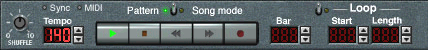

Click on each control to get a description.

| Knob / Control / Switch | Operational Description | Context ID |
|---|---|:---:|
| **Shuffle Amount** | This determines the amount of Shuffle. Shuffle is an effect where the sixteenth notes that fall in between the eighth notes are delayed by various amounts, to create a "swing" feel. You can turn Shuffle on/off for each section in the Pattern sections. | `54BQNKP` |
| **Song Mode/Pattern Mode** | This switch switches ReBirth RB-338 between its two major modes: Pattern mode and Song mode. The two modes have major differences. Below we will list the properties for each one, in list form: Pattern Mode Designed for programming the synths and rhythm sections. Allows you to manually set all knobs as you like them at any time. The Fast Forward and Rewind controls are not used. Always loops the selected Patterns. The Record button isn't used. Song Mode Allows you to build a complete Song by recording Pattern changes and knob movements. Provides automation of Pattern selection and controls. Introduces the loop feature that allows you to repeat any section of the song indefinitely. | `157OL3` |
| **MIDI** | This "LED" lights up to indicate incoming MIDI messages. It reacts on all MIDI messages except System Exclusive. Use this as a visual indication that your MIDI setup is done correctly. | `1MT1OGF` |
| **Sync** | This "LED" indicates incoming MIDI sync. It blinks red on the downbeat and green on all other beats. Use this as an indication that the master device (the one transmitting the MIDI Clock messages) is actually started and the MIDI setup is done correctly. This indicator is also used in conjunction with the "Live Sync" feature, which allows you to start and stop ReBirth and even switch between Song documents, without losing sync. See the documentation for details. | `3OE13AE` |
| **Tempo** | Here you can set the tempo for your song in "bpm" (beats per minute). The range is 20 to 500 bpm (80 to 160 is a "normal" range of tempos). When ReBirth is synchronized to another device, this setting is of no importance, since ReBirth will play in the tempo of the other device. | `64RVFW` |
| **Bar Display** | This shows the current position in bars (measures). Only relevant in Song mode. If you click the arrow, the Song Position is moved one measure back/forward. If you keep the mouse button down, it scrolls continuously. | `6PKT_NW` |
| **Play** | This activates playback. If you are in Song mode, this should be thought of as "continue play", that is it will start playback from the current position. | `1MT4RDV` |
| **Stop** | When you click this, during playback, the program stops. If the program is already stopped, the song position moves to the Loop Start. There’s an exception to this: If the Song Position is already at an earlier position then the Left Locator, it moves to the beginning of the Song. If you click one more time, the Song position moves to the beginning of the Song. In other words, clicking three times always moves you to the beginning of the Song. | `1MT7ZRM` |
| **Rewind** | Every click on this button moves the song position ten bars back. If you keep the mouse button pressed, it rewinds continuously. | `K3VCGE` |
| **Fast Forward** | Every click on this button moves the song position ten bars forward. If you keep the mouse button pressed, it fast forwards continuously. | `12.H4RL` |
| **Record** | This button is used for recording Pattern changes and knob movements in song mode. It has no function in Pattern mode. | `K3BIKE` |
| **Loop On/Off** | When this is activated, the section specified by the Start and Length settings is Looped. | `AEGIM7` |
| **Loop Start and Length** | The Loop start is the bar where you want looping to start. The Length setting is the number of bars you want looped. | `1RDXG31` |

### 4.3 Synth Sections (TB-303 Units 1 & 2)

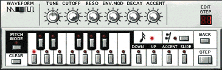

Click on each control to get a description.

| Knob / Control / Switch | Operational Description | Context ID |
|---|---|:---:|
| **Pitch Mode** | When this is activated, the sequencer will automatically advance to the next step as soon as you select a pitch, using the Pitch buttons. When this is deactivated, the sequencer never advances automatically to the next step. If you deactivate and then immediately activate Pitch Mode, you return to the first step in the Pattern. | `0M__.G` |
| **Clear** | This Clears the Pattern completely. This means that all steps are set as follows: Function:	Setting: Pitch	Low C Note/Pause	Pause (no sound!) Down	Off Up	Off Accent	Off Slide	Off | `3BHZ7C5` |
| **Pitch buttons** | These are used to specify a Pitch for the selected step. | `CKG5UQ` |
| **Down and Up** | These transpose the pitch of the selected step down, one octave in the selected direction. You can activate both Up and Down at the same time, if you wish. However, this is the same as activating none of them. | `3H_DZYU` |
| **Accent (button)** | This activates Accent for the selected step. For more information on what effect accent has, see the Accent knob. | `1AOJHF` |
| **Slide** | When this is activated, the selected step will be tied to the next (no "retriggering") and the pitch will change continuously from this step's pitch to the next step's pitch. | `1UI_QY` |
| **Note/Pause button and indicators** | This is used to specify if the selected step will sound or not. | `YIZN4S` |
| **Back** | This takes you to the previous step in the Pattern. When you are at the first step, this takes you to the last Step in the Pattern. | `E46YTR` |
| **Step** | This takes you to the next step in the Pattern. When you are at the last step, this takes you to the first step in the Pattern. | `E4HAVW` |
| **Step Display** | This indicates which step you are currently at, when entering notes. This changes when you press Next or Back or when you specify pitches in Pitch mode. It does not move on playback. | `2GKVVVE` |
| **Waveform** | This allows you to select between two waveforms for the synth oscillator: Name:	Description: Sawtooth	This is a full and rich waveform where all harmonics are included. Square	This waveform only contains odd harmonics, which gives the sound a more "hollow" quality. | `59LU_PB` |
| **Tune** | This allows you to set the tuning of the synthesizer. The range is two octaves in steps of one semitone. | `E4IC4L` |
| **Cutoff** | This sets the basic cutoff frequency for the filter. The higher this setting, the brighter the sound. This is the basic setting filter setting. The final filter curve is determined by other settings, like Env. Mod, Decay and Accent. | `SI_2C6` |
| **Reso (Resonance)** | This also determines the character of the sound. The technical explanation is that it routes the output of the filter back into the input, in a feedback" loop. This knob determines the amount of feedback. The higher the sound, the more of the typical hollow character you will get. | `E4G39V` |
| **Env. Mod (Envelope Modulation)** | This determines the amount of effect the filter envelope has on the filter setting. In its lowest position, the envelope has little effect on the sound. At higher values, the envelope makes the filter open further, that is the sound will be brighter. | `89314O` |
| **Decay** | The higher this setting, the longer it will take for the notes to decay. | `1FB7OB` |
| **Accent (knob)** | This determines the amount of change to those steps that have the accent switch activated. Steps with Accent will be perceived as shorter, louder and with a slightly different tonal character than other steps, when this setting is increased. When this knob is all the way down, steps with Accent will only be shorter. | `9U8VIH` |

### 4.4 808 Rhythm Section (TR-808 Drum Machine)

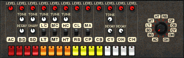

Click on each control to get a description.

| Knob / Control / Switch | Operational Description | Context ID |
|---|---|:---:|
| **Sound selector** | This knob is used to select between the main sounds. Legend	Name	Comment AC	Accent	This is not real a sound, but rather a way to control dynamics. The steps where Accent is activated will be louder. Exactly how much louder is determined by the Accent Level control. This control has equal effect on all sounds. BD	Bass Drum	Has Tone and Decay controls. SD	Snare Drum	Has Tune and Snappy controls. LT	Low Tom	Has a tune control. "Shared" with Low Conga. MT	Middle Tom	Has a tune control. "Shared" with Middle Conga. HT	High Tom	Has a tune control. "Shared" with High Conga. LC	Low Conga	Has a tune control. "Shared" with Low Tom. MC	Middle Conga	Has a tune control. "Shared" with Middle Tom. HC	High Conga	Has a tune control. "Shared" with High Tom. RS	Rim Shot	 "Shared" with Claves. CL	Claves	 "Shared" with Rim Shot. CP	(Hand) Claps	 "Shared" with Maracas. MA	Maracas	 "Shared" with Claps. CB	Cowbell	No comment... CY	Cymbal	Has a Tone and Decay Control. OH	Open Hi-hat	Has a Decay Control. Is cut off by the Closed Hi-hat. CH	Closed Hi-hat	Cuts off the Open Hi-hat. If you have both open and closed Hi-hat on one step, you will only hear the Closed Hi-hat. | `FO7ZCX` |
| **Sound selector shortcuts** | Clicking on these allows you to quickly select one of the sounds, instead of using the main sound selector knob | `10A6N3O` |
| **Shared Sound Switches** | Some instrument "slots" can only play one of two sounds. In these cases, these small switches allow you to select which sound will be played by this instrument "slot". You can flick the switch any time. Whatever is programmed for this "instrument slot" will be played by the sound selected at that time. | `50KZGW` |
| **Step buttons** | These buttons are used to program the rhythm for the selected sound. Each button represents a step in the Pattern. Click to activate/deactivate. Steps that are lit up will play. | `3C5I37` |
| **Level controls** | These are used to set the levels of each rhythm instrument. | `BACMT7` |
| **Sound Controls** | Tone	This knob adjusts the "color" of the sound. Exactly in which way depends on the sound, but the higher the setting, the "brighter" the sound. Decay	This adjusts the length of the sound. The higher the setting, the longer the sound. Tune	This adjusts the pitch of the sound. On the Snare Drum it only affects the "tone" part of the sound, not the "snare" part. Snappy	This is only available for the Snare Drum. It is actually a level control for the "snare" (noise) part of the sound. The higher the setting, the more of the "snare" you will hear. | `2N3K0DB` |

### 4.5 909 Rhythm Section (TR-909 Drum Machine)

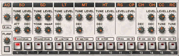

Click on each control to get a description.

| Knob / Control / Switch | Operational Description | Context ID |
|---|---|:---:|
| **Sound selectors** | Clicking on these allows you to select one of the sounds. Legend	Name	Comment AC	Accent	This is not real a sound, but rather a way to control dynamics. The steps where Accent is activated will be louder. Exactly how much louder is determined by the Accent Level control. This control has equal effect on all sounds. BD	Bass Drum	Has Tune, Attack and Decay controls. SD	Snare Drum	Has Tune, Tone  and Snappy controls. LT	Low Tom	Has  Tune and Decay controls. MT	Middle Tom	Has Tune and Decay controls. HT	High Tom	Has Tune and Decay controls. RS	Rim Shot CP	(Hand) Claps CH	Closed Hi-hat	Has a Decay Control. Cuts off the Open Hi-hat. If you have both open and closed Hi-hat on one step, you will only hear the open  Hi-hat. Shares Level with open hi-hat. OH	Open Hi-hat	Has a Decay Control. Is cut off by the Closed Hi-hat.  Shares Level with closed hi-hat. CC	Crash Cymbal	Has a Decay Control. RC	Ride Cymbal	Has a Decay Control. | `XX3A9Q` |
| **Step buttons** | These buttons are used to program the rhythm for the selected sound. Each button represents a step in the Pattern. Click once to get a weak hit (light indicator). Click again to get a loud hit (bright indicator). Click a third time to turn off (no indication). | `1MCLXMP` |
| **Sound Controls** | Level	This adjusts the level of each sound. Tune	This adjusts the pitch of the sound. On the Snare Drum it only affects the "tone" part of the sound, not the "snare" part. Tone	This knob adjusts the length of the "snare" part of the snare drum sound. Snap(py)	This is only available for the Snare Drum. It is actually a level control for the "snare" (noise) part of the sound. The higher the setting, the more of the "snare" you will hear. Att(ack)	Adjusts the click in the beginning of the bass drum. Dec(ay)	This adjusts the length of the sound. The higher the setting, the longer the sound. | `1QM38PP` |
| **Flam on/off** | When this is activated, steps that you program will play flam hits rather than regular hits. | `VLGCG4` |
| **Flam amount** | This knob adjusts the "width" of flams, that is, the time between the first and second hit in a flam. | `9K69_Q` |

### 4.6 Pattern Section

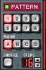

Click on each control to get a description.

| Knob / Control / Switch | Operational Description | Context ID |
|---|---|:---:|
| **Bank and Pattern selectors** | These are used to select between the 32 Patterns available for each section in each Song. To select another Pattern, in the same Bank, simply click one of the Pattern buttons. To switch to another Pattern in another Bank, first select the Bank, then the Pattern. No Pattern gets selected until you click one of the Pattern buttons 1 to 8. You can also switch Patterns from the computer keyboard, see the Operation Manual. | `W80ZTN` |
| **Step display and setting** | This is used to set the length of the Pattern, in steps of 16th notes. This can be done at any time and affects playback immediately. You can even have different Pattern lengths for different sections. Each one loops independently. Different Patterns can have different lengths. | `FPJ76X` |
| **Focus Bar** | Many operations can only be applied to one of the synths or the rhythm section. Which section the function actually affects is determined by where the focus is. The focus is indicated by this vertical orange bar, the focus bar. The focus bar is automatically moved when you click in a section. You can also move it by using the up and down arrows on the computer keyboard. | `1MJAC9.` |
| **Pattern On/Off** | This is used to turn a section On/Off. This can be used as an extra, silent Pattern. | `320XMXO` |
| **Shuffle On/Off** | This is used to turn the Shuffle effect on off for this section. Shuffle is an effect where the sixteenth notes that fall in between the eighth notes are delayed by various amount,,s to create a "swing" feel. You adjust the amount of Shuffle on the Transport bar. | `1MKWXUA` |

### 4.7 Mixer Sections

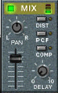

Click on each control to get a description.

| Knob / Control / Switch | Operational Description | Context ID |
|---|---|:---:|
| **On/off switch** | This turns the output of the relevant section on/off. | `FEL94.` |
| **Meter** | This shows the output level from the section. Use this as a diagnostic tool if the level from a section is very low or if you don't hear it at all. If this meter shows any indication at all, the section is playing. | `18LO_JX` |
| **Volume fader** | This determines the level of the output from the relevant section. Use this to balance the relative levels between the synths and the rhythm sections. {bmc onestep.bmp]	Please note that as you increase levels you might run into distortion. To compensate for this, use the fader in the Master section. | `0GXRF9` |
| **Pan** | This determines the section's position in the stereo image. The range of the parameter is fully left (L), via center ("twelve o'clock") to fully right (R). | `DE37NB` |
| **Comp** | This is a switch that routes the output of this section through the Compressor. | `2SCK_.3` |
| **Dist** | This is a switch that routes the output of this section through the Distortion (Dist) unit. | `4IG90M` |
| **PCF** | This is a switch that routes the output of this section through the PCF (Pattern Controlled Filter) unit. | `DE37P0` |
| **Delay** | This determines the amount of delay (echo) to be added to this section. The final amount of delay is determined by a number of other settings, in the actual Delay section. | `F0C5ZO` |

### 4.8 PCF (Pattern Controlled Filter) Section

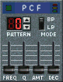

The PCF is an extremely versatile synth effect. It allows you to change the sound from any of the sections in ReBirth RB-338, in a number of ways. Basically, the PCF is a filter with an envelope, just like there are filters with envelopes in the synth sections. You route the output of one of the sections through the PCF and thereby shape the tonal character of the sound. The main difference between the PCF and the synth filters is that this filter is "pattern controlled". There are a number of preset patterns that allow the filter to "superimpose" pumping effects, slow sweeps and rhythmic phrasing onto the sound. Click on each control to get a description.

| Knob / Control / Switch | Operational Description | Context ID |
|---|---|:---:|
| **On/Off switch** | This turns the PCF effect on/off. When turned off, sound will pass through the effect without any filtering. This button is very similar to a Bypass button on a regular effect unit. | `VHKEIW` |
| **Meter** | This shows the input level to the PCF. Use this as a diagnostic tool if you are unsure if any signal appears at the input of the PCF section. If this meter shows any indication at all, some signal is coming in. | `9_6K1S` |
| **Pattern** | There are a large number of preset patterns that provide various rhythmic effects. They do this by controlling the following envelope parameters: Retriggering. This is the most basic type of control. In Pattern 1 for example the envelope is retriggered (restarted) at each whole note, in pattern 2 on each half note etc. Dynamic and Attack control. In many of the Patterns, the envelope is triggered with different dynamics on different "beats". Some "beats" also have a slightly different attack. The Patterns are preset, they can not be changed. Their length varies, most are 16 or 32 steps (one or two bars), but some have been created in odd time signatures. The patterns are roughly divided into the following categories: Pattern #:	Description: 0 to 5	Even rhythms, no dynamics. 6 to 11	Simple rhythms, no dynamics. 12 to 17	Simple sweeps, slow dynamics. Try these with long decay times! 18 to 21	Complex sweeps (more or less random). 22 to 33 	Complex rhythms with dynamics and varying attacks. 34 to 46	32nd note patterns. 47 to 54	Additional variations. | `6M1SE2` |
| **Mode (BP/LP)** | This switches the filter between its two major modes, lowpass and bandpass. The lowpass filter (LP) is similar to the one used in the synth sections in ReBirth. It lets all harmonics below a certain frequency (the cutoff frequency) pass through. The bandpass filter (BP) only lets frequencies within a certain band (a range of frequencies) pass through. | `RU_INP` |
| **Freq (Frequency)** | This is the main frequency range the filter should operate in. The Freq parameter is related to the Amount (Amt) parameter: If the Amount slider is set to zero, there will be no pattern effect at all. The filter can then be used as a fixed "tone control" by adjusting the Freq and Q parameters. If the Freq slider is all the way up, the Amt slider has no effect since the filter is already fully open. | `5KUM8L` |
| **Q** | This is the same as the "Reso" control in the synth sections. Technically it routes the sound at the output of the filter back to the input, in a feedback loop. Soundwise it gives the sound a more hollow, pronounced character. Be careful when combining large Q values in the PCF with large Reso values in a synth, since this might lead to overloading the output of the PCF, causing distortion. | `10AGFO3` |
| **Amt (Amount)** | This control determines the amount of effect the envelope has on the filter. For any Pattern effect at all, this must be set to some value above zero. | `27.IG7` |
| **Decay** | This adjusts the length of the envelope decay. This has a significant effect on the "feel" of the Pattern. At low values there will be a clear pumping effect. When the Decay is raised, the pattern effect will be "smeared". This can be used to good effect with Patterns 12 to 17 for smooth "LFO" effects. At very high values, the envelope will not be given a chance to decay very much until it is retriggered, giving a "stepping" effect (similar to the old synth effect "sample and hold"). This is most noticeable on patterns with dynamics (12 and above). | `9469XZ` |

### 4.9 Delay Section

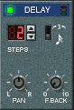

Delay is an effect that adds repeats or echo to the sound. This is a "send effect", which means that any and all sections can be routed to this effect, by variable amounts. Click on each control to get a description.

| Knob / Control / Switch | Operational Description | Context ID |
|---|---|:---:|
| **On/off switch** | This turns the Delay effect on/off. When turned off, any sound will pass through the effect without any delay added. This button is very similar to a Bypass button on a regular effect unit. | `1PHDP3P` |
| **Meter** | This shows the input level to the Delay. Use this as a diagnostic tool if you are unsure if any signal appears at the input of the Delay section. If this meter shows any indication at all, some signal is coming in. | `A3NUZ.` |
| **Steps and Straight/Triplet switch** | These two controls determine the length of the Delay. If the Straight/Triplet switch is set to straight 16th notes, Steps is used to set the length in 16th note steps. If the Straight/Triplet switch is set to triplets, Steps is used to set the length in steps of 8th note triplets. | `PG2..K` |
| **Feedback** | To get more than one echo, you can route the output of the Delay unit, back to its input. This is often referred to as Feedback. The F.Back knob on the ReBirth delay does exactly this. Please be careful when raising this knob to high values. At full value, the echo repeats infinitely. While this can be used to good effect, it is something to be aware of. | `2VO.TV` |
| **Pan** | This determines the position of the delay output, in the stereo image. The range of the parameter is fully left (L), via center ("twelve o'clock") to fully right (R). | `.7H__H` |

### 4.10 Distortion (Dist) Section

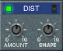

Distortion is an effect that makes the sound "dirtier". All sections can be routed to the Distortion effect, by using the Dist switches in the mixers. Click on each control to get a description.

| Knob / Control / Switch | Operational Description | Context ID |
|---|---|:---:|
| **On/off switch** | This turns the Distortion effect on/off. When the Distortion is turned off, any sound will pass through the effect without being distorted. This button is very similar to a Bypass button on a regular effect unit. | `3MWJ_CH` |
| **Meter** | This shows the input level to the dist. Use this as a diagnostic tool if you are unsure if any signal appears at the input of the Dist section. If this meter shows any indication at all, some signal is coming in. | `1L9HCRO` |
| **Amount** | This determines the amount of distortion. The higher the setting, the dirtier the sound. | `51S_8WP` |
| **Shape** | This determines the character of the distortion. | `.X31YM` |

### 4.11 Compressor (Comp) Section

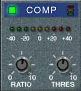

A compressor evens out levels to make the sound "tighter". At high settings it can introduce a "pumping" effect. The compressor in ReBirth RB-338 is an insert effect that can be applied on the output of one of the sections or on the master out. There is only one Compressor. This means that only one section or the master output can use the compressor. Click on each control to get a description.

| Knob / Control / Switch | Operational Description | Context ID |
|---|---|:---:|
| **On/off switch** | This turns the Compressor effect on/off. When the Compressor is turned off, any sound will pass through the effect without being distorted. This button is very similar to a Bypass button on a regular effect unit. | `67K1_7O` |
| **Meter** | This shows the input level to the Compressor. Use this as a diagnostic tool if you are unsure if any signal appears at the input of the Compressor section. If this meter shows any indication at all, some signal is coming in. | `OTIES1` |
| **Threshold** | This is a setting for which signals should be affected. As the name implies, only levels above the one you specify here (the Threshold) will be affected. Levels below this value will pass through unprocessed. | `LNFALH` |
| **Ratio** | This is the amount of level reduction, that is, the resulting reduction in level difference. The higher the setting, the more drastic the effect. | `OYEEVY` |
| **Level Reduction Meter** | This display shows you how much the level of the signal is reduced at any given time. The "0" setting (in the middle) means no change, whereas an indication to the left implies a level reduction. | `0MTLZB` |

### 4.12 Master Section

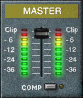

The Master level fader and meters. Click on each control to get a description.

| Knob / Control / Switch | Operational Description | Context ID |
|---|---|:---:|
| **Meters** | These show the Output level from the entire program. Adjust this with the fader, so that the meters show as high levels as possible during loud passages, without hitting the top segments in the red section. | `17LY3GM` |
| **Fader** | This is used to adjust the overall output level from the program. Use this together with the meters to retain maximum level without clipping. | `17ETNGM` |
| **Comp** | When this is activated, the complete stereo mix will be routed through the Compressor. | `1BKKZZ7` |

## 5. General Help & System Notes

### About This Help System
This Windows Help system provides reference material for all sections, menu items and dialogs in ReBirth RB-338. It is intended as a complement to the complete Operation Manual (click the green link to launch Acrobat and open the file). To get help on the Song window, select Contents from the Help menu, and select one of the topics. To get help on a dialog or window, press [F1]. To get help on a menu item, pull down the menu and position the mouse pointer over the item, without releasing the mouse. Then press [F1]. To get Help on specific items in dialogs, click on the small '?' symbol in the title bar of the dialog and click on the item you need help on.
